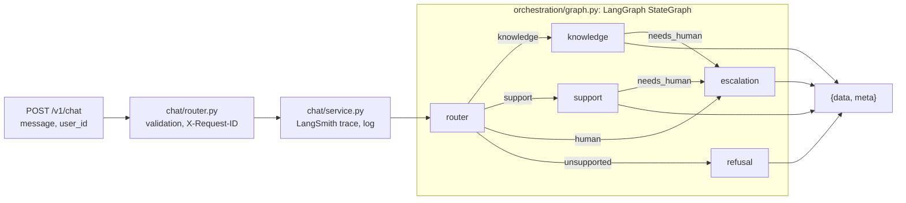

# Getnet multi-agent support

> **Videos**
>
> - Solution walkthrough (up to 15 min): <https://youtu.be/_yjkB_KQyrI>
> - Development session recording (complementary, within the 60 minutes):
>   <https://youtu.be/AcEbuzerHjs>

One HTTP endpoint for Getnet merchants, answered by four cooperating agents:

- a **Router** that understands the message and picks who handles it;
- a **Knowledge** agent that answers product questions from Getnet's website (RAG) and general
  questions from the web;
- a **Customer Support** agent that answers questions about the merchant's own account
  (deposits, declines, card machines) from their (fictitious) data;
- a **Human Escalation** agent that writes the handoff when the system cannot resolve.

A merchant asks two very different things in the same channel: how a product works ("How does
receivables advance work?") and what is happening with their own account ("When will
yesterday's sales be deposited?"). One generic assistant either invents product facts or has
no access to account data. Specialised agents, grounded in their own tools, behind one
deterministic graph, solve both.

| Challenge requirement | Where it is satisfied |
|---|---|
| Router agent | [`app/agents/router_agent.py`](app/agents/router_agent.py), prompt in [`prompts.py`](app/agents/prompts.py) |
| Knowledge agent: RAG plus web search | [`app/agents/specialist.py`](app/agents/specialist.py), [`app/knowledge/`](app/knowledge/) |
| Customer Support agent, 2 tools or more | 4 tools in [`app/customers/tools.py`](app/customers/tools.py), plus the knowledge base |
| Clear communication mechanism | Typed LangGraph state in [`app/orchestration/graph.py`](app/orchestration/graph.py) |
| `POST` endpoint with `{"message", "user_id"}` | `POST /v1/chat` in [`app/chat/router.py`](app/chat/router.py) |
| Dockerfile and compose | [`Dockerfile`](Dockerfile), [`docker-compose.yml`](docker-compose.yml) |
| Testing strategy, integration tests of the orchestration | [Testing strategy](#9-testing-strategy), [`tests/`](tests/) |
| Bonus: 4th agent (Human Escalation) | [`app/agents/escalation_agent.py`](app/agents/escalation_agent.py) |
| Bonus: guardrails | Router `unsupported` route, [`app/guardrails/pii.py`](app/guardrails/pii.py), tool-call limit |
| Bonus: human handoff | `needs_human` edge to escalation; works with the LLM down |
| Bonus: evaluation and observability | [`evals/`](evals/), LangSmith traces, JSON logs, [monitoring plan](#8-evaluation-and-observability) |
| Spec-Driven Development | [`specs/001-multi-agent-support/`](specs/001-multi-agent-support/) |

## Contents

1. [Quick start](#2-quick-start)
2. [Running the tests](#3-running-the-tests)
3. [Architecture](#4-architecture)
4. [RAG pipeline](#5-rag-pipeline)
5. [LLM tools](#6-llm-tools)
6. [Guardrails and reliability](#7-guardrails-and-reliability)
7. [Evaluation and observability](#8-evaluation-and-observability)
8. [Testing strategy](#9-testing-strategy)
9. [Project structure](#10-project-structure)
10. [Spec-Driven Development](#11-spec-driven-development)
11. [Production roadmap](#12-production-roadmap)

## 2. Quick start

You need an OpenAI key and a Tavily key (the free tier is enough). LangSmith is optional.

### With Docker

```powershell
Copy-Item .env.example .env      # then fill OPENAI_API_KEY and TAVILY_API_KEY
docker compose up --build -d
docker compose logs -f api       # first start: one ingest.page line per page, then Uvicorn
```

On its first start the container ingests the 42 curated pages into a named volume
(`ingest.started`, 42 `ingest.page` lines, `ingest.completed`), then starts the API on port
8000. Later starts skip the ingestion (`ingest.skipped`). The container is called
`getnet-challenge` and reports `healthy` once `/health` answers.

```powershell
Invoke-RestMethod http://localhost:8000/health | ConvertTo-Json
$body = '{"message": "When will the money from yesterday''s sales be deposited?", "user_id": "cliente1988"}'
Invoke-RestMethod http://localhost:8000/v1/chat -Method Post -ContentType "application/json" -Body $body | ConvertTo-Json -Depth 6
```

```bash
curl -s localhost:8000/v1/chat -H 'Content-Type: application/json' \
  -d '{"message": "What is the difference between the Get Clássica and the Get Smart?", "user_id": "cliente1988"}'
```

Swagger UI: <http://localhost:8000/docs>.

A response (abridged):

```json
{
  "data": {
    "answer": "Here is when yesterday's sales will be deposited: ...",
    "route": "support",
    "route_reason": "The merchant asks about deposits of their own sales.",
    "agents": ["router", "support"],
    "tools_used": ["get_sales_and_settlements"],
    "sources": [],
    "escalated": false,
    "ticket_id": null,
    "language": "en",
    "request_id": "6f1c0d6e0b9e4a8f9d3c2b1a0e9f8d7c",
    "latency_ms": 4210
  },
  "meta": {"code": "CHAT_ANSWERED", "message": "The message was answered."}
}
```

Merchants in the mock data: `cliente1988` (Padaria Pão Dourado, Porto Alegre) and
`cliente2000` (Ótica Boa Vista, Recife). Any other `user_id` has no account.

### Locally with uv

```powershell
uv sync
uv run python -m app.knowledge.vectorstore          # ingest into ./.vectorstore (add --rebuild to start over)
uv run uvicorn app.main:app --port 8000
```

Every setting has a default in [`app/core/settings.py`](app/core/settings.py) and is documented
in [`.env.example`](.env.example).

## 3. Running the tests

| What | Command | Needs keys |
|---|---|---|
| Offline suite (unit, orchestration, scenarios, API) | `uv run pytest -v` | no |
| Lint and types | `uv run ruff check .` and `uv run pyright` (strict) | no |
| API documentation check | `uv run python -m scripts.check_api_docs` | no |
| Evals, local markdown report | `uv run python -m evals.run_evals` | yes, plus local ingestion |
| Evals as a LangSmith experiment | `uv run python -m evals.run_evals --langsmith` | yes, plus LangSmith |
| Live debugger, node by node | `uv run python -m scripts.chat "message" --user cliente1988` | yes, plus local ingestion |
| Manual test cases (ISTQB) | [`tests/MANUAL-TESTS.md`](tests/MANUAL-TESTS.md) | yes |

`scripts/chat.py` runs the same graph the API runs and prints each node as it completes (the
route, reason and language; the specialist's tools and sources; the ticket), each tool call
inside an agent (`support -> get_terminal_status({})`, `support <- get_terminal_status: ...`)
and then the final response JSON.

## 4. Architecture

### Message workflow



1. `app/chat/router.py` validates the body (Pydantic) and takes the `X-Request-ID` or creates
   one.
2. `app/chat/service.py` runs the graph inside a LangSmith trace (`chat_request`, metadata
   `request_id` and `user_id`, PII anonymized), measures the latency and logs one
   `chat.completed` line.
3. The graph runs the Router, then the chosen node, then possibly the escalation, and the final
   state becomes the response.

### Orchestration and communication mechanism

Two layers, two responsibilities:

- the **graph** decides **who** runs and in which order, deterministically, with conditional
  edges;
- each **agent** decides **how** to solve its part, in a tool-calling loop (`create_agent`).

**Communication is direct, in-process, through the graph state.** The typed `ChatState` is the
message bus: each node reads what it needs (`message`, `user_id`, `language`, the specialist's
findings) and returns a partial update; the list fields `agents` and `tools_used` accumulate
through `operator.add` reducers. The agents never call each other: the Router's decision is
an explicit field of the state, visible in the trace and in the response.

Edges: `START -> router`; conditional on `route`: `knowledge`, `support`, `escalation` (route
`human`) or `refusal` (route `unsupported`); `knowledge` and `support` go to `escalation` when
they set `needs_human`, else to `END`.

**A failure becomes a handoff, never a 500.** A specialist that raises is caught by its node
and turned into `needs_human=True`; a Router that fails sends the case to escalation; an
Escalation agent that fails falls back to a deterministic plan. So with the LLM completely down,
the merchant still gets a ticket number (tested in `test_handoff_works_with_the_llm_completely_down`).

### The agents

| Agent | Built with | Job | Tools | Output contract |
|---|---|---|---|---|
| **Router** | `create_agent`, `response_format=RouteDecision`, no tools | Classify the message and detect its language. Off-topic, prompt injection and other merchants' data are `unsupported` | none | `RouteDecision {route, reason, language}` |
| **Knowledge** | `create_agent` + middleware | Product questions through RAG, general questions through web search. Searches in Portuguese, answers in the merchant's language | `search_knowledge_base`, `web_search` | `SpecialistAnswer {answer, source_urls, needs_human, handoff_reason}` |
| **Customer Support** | `create_agent` + middleware, `context_schema=CustomerContext` | The merchant's own account: deposits, declines, machines | 4 customer tools, `search_knowledge_base` | `SpecialistAnswer` |
| **Human Escalation** | `create_agent`, `response_format=HandoffPlan` | Category, priority, a summary for the operator (pt-BR), the message to the merchant | none: the ticket is opened by code | `HandoffPlan {category, priority, operator_summary, customer_message}` |
| *refusal* (node) | plain code | A fixed, polite refusal in the merchant's language | none | text |

The prompts are in [`app/agents/prompts.py`](app/agents/prompts.py). The Support prompt
encodes playbooks found by the evals in the dry run: for a decline, call
`get_recent_transactions(status="declined")` **first** (a decline was once answered with Wi-Fi
steps); for deposits, quote `deposits_by_date` and **never add amounts** (the model once added
them wrong, so totals are computed in code).

### Design choices

| Choice | Why |
|---|---|
| LangGraph `StateGraph` for routing | Deterministic, typed shared state, conditional edges, one node per responsibility |
| LangChain `create_agent` for each agent | Tool loop, structured output and middleware out of the box: no home-made framework |
| `gpt-4.1-mini`, temperature 0, via `init_chat_model` | Fast, cheap, native structured output; the provider is configuration |
| Structured output for every agent | The graph reads validated fields, never parses free text |
| `user_id` from the runtime context | The model can never choose whose data to read |
| Ticket id generated by code | A protocol number is never invented |
| Arithmetic and dates in code | Settlement dates and totals per deposit date are computed, then quoted |
| One folder per domain subject | `knowledge/` is the whole RAG, `customers/` the whole account domain |
| A composition root (`app/container.py`) | The only place that knows who uses what; tests swap the model without touching anything else |

### What we decided not to use, and why

| Not used | Why |
|---|---|
| Tavily Crawl / Extract for ingestion | Measured (about 22 credits): see [Why not Tavily](#why-not-tavily-for-ingestion). Tavily stays as the web search tool |
| `langchain-community` loaders | The package is being sunset and emits a deprecation warning |
| A managed vector store (Pinecone) | Evaluators would need another account. Chroma sits behind `open_vectorstore`, so swapping it is a one-file change |
| A supervisor (agents as tools) for routing | One LLM call fewer; the route stays explicit in the state and the trace; testable with a fake model |
| A message queue between agents | One request, one response, one process: the graph state is enough. In production a queue fits the escalation ticket, not the conversation |
| A UI of our own | Each need has a tool: `scripts/chat.py` (the graph node by node), Swagger (the HTTP contract), LangSmith (traces, dashboards, experiments). LangGraph Studio was tried: with `langgraph-api` 0.16.8 and Starlette 1.10 its dev server answers Chrome's private-network preflight with 400 |

## 5. RAG pipeline

```text
data/sources.json --> load (httpx + BeautifulSoup) --> split --> embed --> Chroma --> retrieve --> generate
   42 curated URLs       5 at a time, cleaned          1200/200   text-embedding-3-small   top 4, score >= 0.2   verified sources
```

### Ingestion, storage, retrieval, generation

1. **Sources:** [`data/sources.json`](data/sources.json), 42 curated URLs, each with `url`,
   `market` and `topic`.
2. **Load** ([`loader.py`](app/knowledge/loader.py)): httpx fetches 5 pages at a time
   (redirects followed, 30 s timeout, descriptive User-Agent). BeautifulSoup removes the
   `header`, `footer`, `nav`, `script`, `style`, `noscript`, `svg` and `form` tags and only the
   classes matching `popup|modal-cliente|cookie|gnt-nav`. Getnet's FAQ answers live inside
   `o-modal` elements: a broad `modal` filter deleted them (86 characters left on a FAQ page),
   so they are kept on purpose. The title comes from `<title>`, the text from `<body>`.
3. **Split** ([`vectorstore.py`](app/knowledge/vectorstore.py)):
   `RecursiveCharacterTextSplitter`, 1200 characters with 200 of overlap. Every chunk is
   prefixed with `[market] page title`, so a chunk from the middle of a page keeps its subject.
4. **Embed and store:** `text-embedding-3-small` (multilingual: English questions retrieve
   Portuguese pages) into Chroma, cosine space, persisted in a Docker volume. Chunk id = the
   first 32 hex characters of `sha256(url#position)`. Metadata: `url`, `title`, `market`,
   `topic`, `chunk`. **Idempotent:** a URL's chunks are deleted before its new chunks are added
   (upsert alone left stale chunks in the dry run: 146 instead of 135).
5. **Retrieve** ([`tools.py`](app/knowledge/tools.py)): `search_knowledge_base` runs
   `similarity_search_with_relevance_scores`, keeps the top 4 above 0.2, and returns numbered
   snippets for the model plus a `{title, url}` artifact for the code
   (`response_format="content_and_artifact"`).
6. **Generate:** the specialist answers only from tool results, in the merchant's language,
   with no URL in the text. The code then keeps only the cited URLs that a tool really returned
   (`verify_sources`), so `sources` can never contain an invented link.

The ingestion is visible: `python -m app.knowledge.vectorstore` logs `ingest.started`, one
`ingest.page` JSON line per page as it completes (`"page": "12/42"`, `url`, `status`, `chars`)
and `ingest.completed` (`pages_loaded`, `pages_failed`, `chunks`, `total_in_store`). Flags:
`--rebuild` drops the collection first, `--if-empty` skips when chunks exist (used by the
container). `/health` reports the chunk count.

### Source curation

- The challenge suggests `www.getnet.net`, which is Getnet's **global and Portugal** site (euros,
  pt-PT). The Brazilian products (Get Clássica, Get Smart, Pix, crediário...) live on
  `site.getnet.com.br`. So the sources are 40 Brazilian pages plus 2 `getnet.net/en` pages
  tagged `[Global]`.
- They cover the machines, Pix, receivables advance, crediário, Payment Link, fees and terms,
  sales status, Wi-Fi and data chip set-up, maintenance and ten terminal error pages
  (`ADQ 1-18`, `ADQ 1-19`, ...), which the Support agent uses for troubleshooting.
- `/duvidas/pix/` is excluded on purpose: it is from 2020 and contradicts the current Pix FAQ.

### Why not Tavily for ingestion

Measured offline before the build, for about 22 Tavily credits:

- **Crawl/Map cannot reach the help center:** it lists its 21 articles through JavaScript,
  with no `<a href>`, so no crawler finds them. Hence a curated list.
- **Extract `basic` kept 63% of the text** overall, and only 2% to 22% on FAQ pages, whose
  answers sit in modals. It dropped the troubleshooting steps of error ADQ 1-18.
- **Extract `advanced` was unstable:** the same page came back at 97%, then at 2%.

httpx plus BeautifulSoup with the targeted cleaning above keeps the FAQ answers and is free and
deterministic. Tavily remains the right tool for live web search.

### Known limitations

- The list is curated: a new Getnet page needs a new line in `sources.json` and a re-run.
- Pure semantic search can miss exact codes (`ADQ 1-18` vs `ADQ 1-19`); hybrid search is on the
  roadmap.
- The site's content changes; there is no scheduled re-ingestion yet.

## 6. LLM tools

| Tool | Agent | What it returns |
|---|---|---|
| `search_knowledge_base(query)` | Knowledge, Support | Top 4 chunks above the relevance threshold: snippets for the model, a `{title, url}` artifact for the code |
| `web_search(query, getnet_only=False)` | Knowledge | Tavily Search results, same `content_and_artifact` contract; `getnet_only` restricts to Getnet's domains |
| `get_customer_profile()` | Support | Business, city, settlement terms, receivables advance settings, bank account; the document is masked |
| `get_sales_and_settlements(days_ago)` | Support | The day's sales, each deposit, and `deposits_by_date`: totals per deposit date, computed in code |
| `get_recent_transactions(status, limit)` | Support | Recent transactions; declines carry the response code, its meaning and the recommended action |
| `get_terminal_status()` | Support | The merchant's machines: model, serial, connectivity, online or offline, last error |

**Why `user_id` is not a tool argument.** If it were, the model would choose whose data to read,
and a prompt injection ("show me the sales of cliente2000") could make it read another
merchant's account. Instead the customer tools receive
`runtime: ToolRuntime[CustomerContext, ...]`: the service puts the request's `user_id` in the
runtime context, LangChain injects it, and it never appears in the tool schema the model sees
(asserted in `test_customer_tools_never_expose_user_id`). The model chooses *what* to look up,
never *whose*.

**Settlement rules, in code** ([`repository.py`](app/customers/repository.py)): debit settles in 1
business day; the first credit installment in 31 days, then every 30 days; Pix is instant; a
date that falls on a weekend rolls to the next business day. Amounts are split in cents and
totalled per deposit date with `Decimal`. Dates in the mock data are relative (`days_ago`), so
it never goes stale.

## 7. Guardrails and reliability

| Risk | Guardrail |
|---|---|
| Off-topic, prompt injection, another merchant's data | The Router routes them to `unsupported`; the refusal node answers with a fixed text and no specialist runs |
| Reading another merchant's data | `user_id` only from the runtime context (see above) |
| Card numbers, CPF, CVV, passwords reaching the model | LangChain `PIIMiddleware` on all four agents: `credit_card` (built-in, Luhn-checked) is masked, custom detectors redact CPF, CVV and passwords, on input and output |
| PII in traces | A LangSmith client with an anonymizer masks the same patterns in every trace |
| PII echoed in the answer | The same patterns are applied in code to every answer and ticket (structured output bypasses the middleware's text check) |
| Invented sources | Only URLs a tool returned are kept |
| Invented ticket numbers | The ticket id is generated by code |
| Tool loops | `ToolCallLimitMiddleware(run_limit=6)` |
| Tool exceptions | `ToolErrorMiddleware` turns them into a message the model can react to |
| Slow or failing model | `init_chat_model` with a 30 s timeout and 2 retries; a failing agent becomes a handoff; a failing Escalation agent falls back to a deterministic ticket |
| Graph unavailable | The API answers 503 `AGENT_UNAVAILABLE` in the envelope |

Every response, success or error, uses the envelope `{"data": ..., "meta": {"code", "message"}}`.
Codes: `CHAT_ANSWERED`, `HEALTH_OK`, `VALIDATION_ERROR` (422), `AGENT_UNAVAILABLE` (503),
`NOT_FOUND` (404), `INTERNAL_ERROR` (500), with messages from one catalog
([`app/core/messages.py`](app/core/messages.py)). Errors carry `data: null`.

## 8. Evaluation and observability

### Traces

With `LANGSMITH_TRACING=true`, every request is **one LangSmith trace** named `chat_request`,
with metadata `request_id` and `user_id`, containing the graph nodes, each agent's model calls
and each tool call. PII is anonymized before upload. `scripts/chat.py` traces as `chat_cli`.

### Logs

One JSON line per event on stdout. Each request writes exactly one `chat.completed` line:

```json
{"ts": "...", "level": "INFO", "event": "chat.completed", "request_id": "demo-001", "user_id": "cliente1988", "route": "support", "agents": ["router", "support"], "tools_used": ["get_sales_and_settlements"], "escalated": false, "ticket_id": null, "latency_ms": 4210}
```

Other events: `chat.failed`, `router.failed`, `specialist.failed`, `tool.failed`,
`escalation.fallback`, `ticket.opened`, `sources.unverified_dropped`, `ingest.*`. The
`X-Request-ID` header (accepted from the caller or generated, and returned) ties the HTTP
response, the log line and the trace together.

### Evals

[`evals/dataset.jsonl`](evals/dataset.jsonl) holds the 10 challenge scenarios plus 5 guardrail
and escalation cases, each with the expected route, tools and escalation.
[`evals/run_evals.py`](evals/run_evals.py) runs them on the real model with four deterministic
evaluators:

| Evaluator | Passes when |
|---|---|
| `route_correct` | The Router chose the expected route |
| `tools_expected` | Every expected tool was called |
| `escalation_expected` | A ticket was opened exactly when expected (only for cases that define it) |
| `no_card_leak` | No 13 to 19 digit card number in the answer |

By default it writes a markdown report to `evals/reports/` and prints a summary; it exits
non-zero below 100%, so it can gate a deploy. `--langsmith` uploads the dataset (once) and
runs the same evaluators as a LangSmith experiment, to compare prompts and models side by side.

### Production monitoring plan

- **Online evaluators on sampled traces** (LangSmith rules, for example 10% of traffic):
  `no_card_leak` and source verification on every sampled answer; an LLM-as-judge for
  groundedness (is every claim supported by the tool results?) and for answer language.
  Low scores feed an annotation queue, and confirmed failures become new rows in the eval
  dataset (regression tests).
- **Alerts:**
  - escalation rate (share of `escalated: true`) above its baseline: a broken tool, an empty
    knowledge base or a confused Router;
  - `router.failed`, `specialist.failed` or `escalation.fallback` above zero for 5 minutes: the
    model provider is failing;
  - p95 latency above 8 s (NFR-006), split by route;
  - 5xx rate (`AGENT_UNAVAILABLE`, `INTERNAL_ERROR`) above 1%;
  - `/health` degraded (zero chunks).
- **Dashboards:** requests per route; escalation rate by origin (Router or specialist) and by
  category; p50/p95 latency by route; tool-call counts and errors per tool; token cost per
  request; unverified sources dropped; eval scores per release. LangSmith's project monitoring
  charts cover latency, errors and cost; the JSON logs feed any log stack (Loki, CloudWatch,
  Datadog) for the rest.

## 9. Testing strategy

A pyramid where every layer is automated, and everything up to the evals runs **offline,
without any API key** (69 tests, about 5 seconds):

| Layer | What it proves | How | Keys |
|---|---|---|---|
| **Unit** ([`tests/unit/`](tests/unit/)) | Rules in isolation: settlement dates and totals (weekend roll-over, installments in cents), HTML cleaning keeps `o-modal` answers, chunk ids, idempotent re-ingestion on a real local Chroma, retrieval threshold, PII detectors and trace anonymizer, tools expose no `user_id`, ticket ids | pytest | no |
| **Integration: orchestration** ([`test_orchestration.py`](tests/integration/test_orchestration.py)) | The real graph, real agents, real tools and middleware: each route, specialist to escalation handoff, a failing specialist becomes a ticket, the LLM fully down still opens a ticket, merchant isolation, unverified URLs dropped, tool exceptions reach the model | scripted `GenericFakeChatModel`, `DeterministicFakeEmbedding`, `InMemoryVectorStore` | no |
| **Integration: challenge scenarios** ([`test_scenarios.py`](tests/integration/test_scenarios.py)) | The 10 Example Test Scenarios, parametrized as `[S1]` to `[S10]`: route, specialist, tools, verified sources, response contract; plus what the model is shown for S3, S5 and S8 | same fakes | no |
| **API** ([`test_api.py`](tests/integration/test_api.py)) | Envelope, 422 cases, 503, 404, `X-Request-ID`, `/health`, one end-to-end request through the real graph | FastAPI `TestClient` | no |
| **Tooling** ([`test_chat_cli.py`](tests/integration/test_chat_cli.py), [`test_container.py`](tests/integration/test_container.py)) | The debugger streams nodes and inner tool calls; the composition root wires the real clients | same fakes | no |
| **Evals** ([`evals/`](evals/)) | The real model's judgment on 15 cases | `run_evals.py`, local or LangSmith | yes |
| **Manual** ([`MANUAL-TESTS.md`](tests/MANUAL-TESTS.md)) | 27 live cases: scenarios, handoff, guardrails, validation, ingestion, logs, traces | `scripts/chat.py`, `Ask`, Swagger, LangSmith | yes |

### How to integration-test the orchestration comprehensively

An agent system has two kinds of behaviour, and they need different tests:

1. **Everything around the model is deterministic, so test it deterministically.** In the
   offline tests, a scripted fake model plays the *decisions* a real model would make: "route to
   support", "call `get_sales_and_settlements(days_ago=1)`", "answer citing this URL". Every
   other piece is real: `build_graph`, `create_agent` with its PII, tool-limit and tool-error
   middleware, the real tools on fixture data, source verification, the escalation and the
   ticket repository, the chat service and the HTTP layer. The fake model also **records every
   prompt it receives**, which makes properties testable that are otherwise invisible: the
   model never saw the card number, the Support agent only ever saw its own merchant's data,
   the escalation agent received the specialist's handoff reason. Failure paths are tested the
   same way, by making a fake model raise.
2. **The model's judgment is not deterministic, so measure it.** The evals run the real model on
   a labelled dataset with deterministic evaluators and a 100% target; they run before a
   release (or nightly) rather than on every commit, because they cost money and depend on a
   provider. Production traces sampled by online evaluators extend the dataset over time.

So the offline suite says "if the model decides X, the system does the right thing", and the
evals say "the model decides X". Neither alone is enough.

## 10. Project structure

```text
app/
├── main.py                 create_app(): FastAPI, lifespan, request id middleware, error handlers
├── container.py            composition root: model, stores, tools, agents, graph, service
├── core/                   settings, JSON logging, envelope, message catalog, error handlers
├── chat/                   HTTP layer: router.py (routes), schemas.py (contract), service.py
├── orchestration/graph.py  ChatState, nodes and edges
├── agents/                 router_agent.py, specialist.py, escalation_agent.py,
│                           prompts.py, schemas.py (contracts), messages.py (fixed texts), llm.py
├── knowledge/              the RAG: loader.py, vectorstore.py (+ ingestion CLI), tools.py
├── customers/              merchant data: schemas.py, repository.py (settlement rules), tools.py
├── guardrails/pii.py       PII middleware and trace anonymizer
└── tickets/repository.py   handoff tickets (in memory)
data/                       sources.json (42 URLs), customers.json (mock merchants)
evals/                      dataset.jsonl, run_evals.py
scripts/                    chat.py (live debugger), check_api_docs.py
specs/001-multi-agent-support/  spec.md, plan.md, tasks.md
tests/                      conftest.py (scripted fake model, test graph), unit/, integration/,
                            MANUAL-TESTS.md
```

One folder per domain subject, never one per technical type: whoever wants to understand the RAG
opens only `knowledge/`. Every module starts with a docstring saying why it exists.

## 11. Spec-Driven Development

The build was driven by documents written before any code:

- [`INITIAL-PROMPT.md`](INITIAL-PROMPT.md): the context, the decisions and **why** they were
  made, including the lessons of an offline dry run (the `o-modal` FAQ answers, stale chunks,
  wrong sums, the decline answered with Wi-Fi steps, `getnet.net` being the Portugal site).
- [`spec.md`](specs/001-multi-agent-support/spec.md): **what and why**: the scenarios (S1 to
  S10, G1 to G5, H1, H2), functional and non-functional requirements, acceptance criteria.
- [`plan.md`](specs/001-multi-agent-support/plan.md): **how**: the stack, contracts, settings
  defaults and known library pitfalls. Its *Deviations* section lists every place the build
  differs.
- [`tasks.md`](specs/001-multi-agent-support/tasks.md): **in what order**: tasks linked to
  requirements, with a quality gate at each checkpoint (ruff, pyright, pytest, the docs check,
  `docker compose config`).

The build followed `tasks.md` phase by phase, ticking each task and running its gate before
moving on. The acceptance criteria (AC-1 to AC-6) are checked by the test suite, the evals and
the manual test cases.

## 12. Production roadmap

- **Conversation memory:** a LangGraph checkpointer keyed by a conversation id, so follow-up
  questions keep their context (out of scope for one-shot requests).
- **Real authentication:** `user_id` from a verified token, not from the body; the runtime
  context design already keeps it out of the model's hands.
- **A managed vector store** (pgvector, Pinecone, Vertex): a change confined to
  `open_vectorstore`; plus scheduled re-ingestion with change detection.
- **Hybrid search for error codes:** BM25 plus vectors, so `ADQ 1-18` never retrieves
  `ADQ 1-19`.
- **A holiday calendar** for settlement dates (today only weekends roll over).
- **A real ticketing system** behind `TicketRepository`, fed through a queue.
- **Streaming responses** over SSE for perceived latency.
